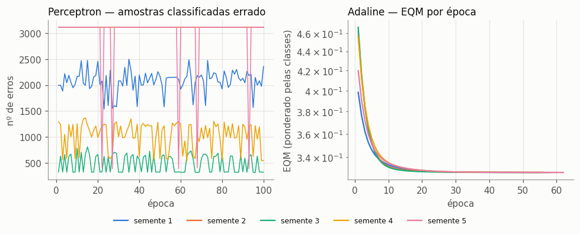
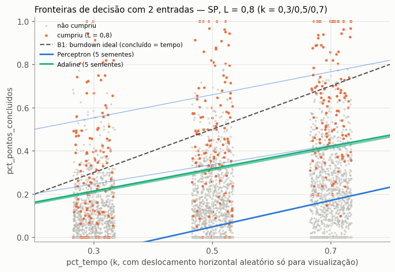
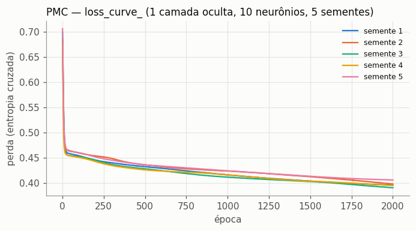
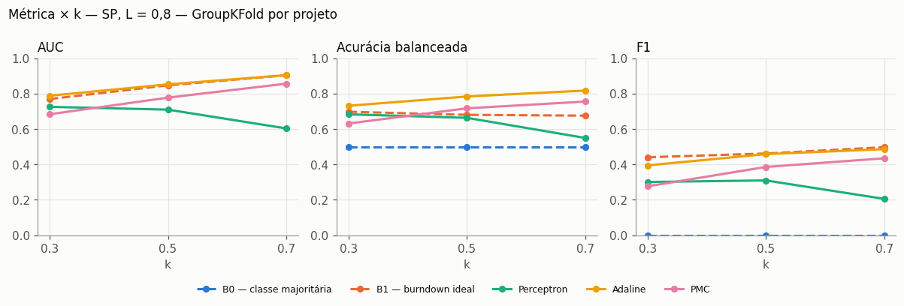
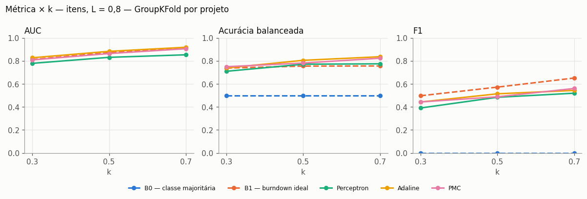
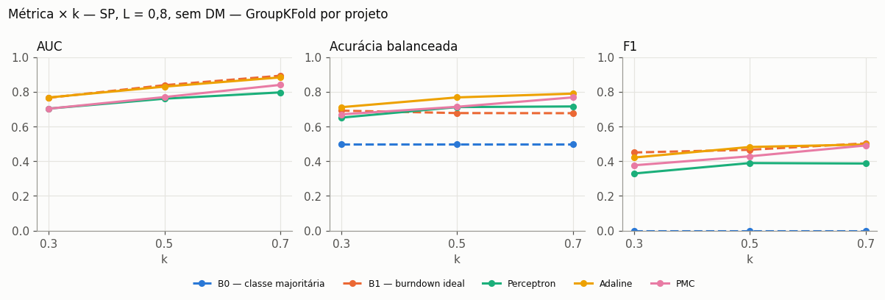

# Resultados — Perceptron, Adaline e PMC

> Gerado por `src/models/relatorio.py` a partir de `reports/resultados/*.csv`. Para reproduzir: `scripts/experimentos.sh`.
> Decisões em vigor (`reports/decisoes.md`): **D1** rótulo `cumpriu = concluído / comprometido ≥ 0,8`; **D2** unidade principal story points, com itens só para robustez; **D3** redes do scikit-learn.

## Resumo

- **Cenário principal (SP, L = 0,8, GroupKFold por projeto, 1.166 Sprints, 10,9% "cumpriu"):** o **Adaline** é a melhor rede. Em k = 0,5, AUC 0,852 contra 0,847 do B1, e acurácia balanceada 0,784 contra 0,680. Ele **empata com B1 em AUC** e o supera em acurácia balanceada.
- O **PMC** (10 neurônios ocultos no treino completo) fica abaixo do Adaline e do B1 em AUC (k = 0,5: 0,777). A não linearidade não ajuda com estas variáveis, e a rede sobreajusta (AUC no treino ≈ 0,900).
- O **Perceptron** não converge: as classes se sobrepõem, então os pesos da última época oscilam. É o pior modelo treinado (k = 0,5: AUC 0,709) e, no cenário principal, piora com k.
- **A curva sobe com k** para B1, Adaline e PMC, nos três cenários.
- **B0** chega a 0,891 de acurácia sem detectar nenhum positivo. Com L = 0,8 a acurácia simples engana; as métricas de decisão são a acurácia balanceada, o F1 e a AUC.

## Protocolo

| Item | Configuração |
|---|---|
| Base | `data/processed/base_modelagem.csv` (uma linha por Sprint × k; um modelo para os três k, avaliado em cada k) |
| Cenários | principal **SP, L = 0,8**; robustez **itens, L = 0,8**; sensibilidade **SP, L = 0,8, sem DM** |
| Variáveis (SP) | pct_tempo, pct_pontos_concluidos, pontos_adicionados_rel, itens_em_andamento_rel, compromisso_vs_velocidade, duracao_dias. Imputação pela mediana + indicador, `log1p`, z-score, tudo ajustado só no treino |
| Divisão | `GroupKFold(5)` por projeto, as mesmas dobras da análise de sinal (`src/analise_sinal.divisao_por_projeto`). Métricas sobre as predições fora da dobra |
| Desequilíbrio | Perceptron e Adaline: pesos de amostra "balanced" (= `class_weight="balanced"`). PMC: sobreamostragem dos positivos só no treino |
| Perceptron | `sklearn.linear_model.Perceptron` (η = 1); pesos iniciais U(−0,5; 0,5); para em época sem erros ou após 100 épocas |
| Adaline | `SGDClassifier(loss="squared_error", penalty=None, learning_rate="constant", eta0=1e-3)`; para quando \|ΔEQM\| ≤ 10⁻⁶ ou após 500 épocas |
| PMC | `MLPClassifier`: 1 camada oculta logística, `solver="sgd"` (retropropagação), η = 0,01, *momentum* 0,9, α = 10⁻² (L2), até 2.000 épocas. Topologia ∈ {5, 10, 15} por GroupKFold(3) **dentro do treino de cada dobra** |
| Sementes | avaliação: 42; experimentos "formato livro": 1 a 5 |

### Equivalência do Adaline com o cap. 4 do livro

| Livro (regra Delta) | `SGDClassifier(loss="squared_error")` |
|---|---|
| saída linear u = Σ wᵢxᵢ − θ (θ = limiar) | `decision_function` = wᵀx + b (b = −θ) |
| EQM = 1/(2p) Σ (d − u)², com d ∈ {−1, +1} | perda ½ (y − wᵀx)², com y ∈ {−1, +1} para a classe positiva |
| ajuste amostra a amostra: w ← w + η (d − u) x | SGD sem penalização e com taxa constante: w ← w + η (y − wᵀx) x |
| parada: \|EQM_atual − EQM_anterior\| ≤ ε | laço de épocas próprio (`partial_fit`) com o mesmo critério (ε = 10⁻⁶) |
| operação: y = sinal(u) | `predict` = sinal(`decision_function`) |

Diferenças: (i) os pesos de classe multiplicam η amostra a amostra; (ii) a ordem das amostras é embaralhada a cada época (`shuffle=True`); (iii) os pesos iniciais são aleatórios pequenos, como no livro (o sklearn começaria em zero).

## Experimento 1 — Perceptron e Adaline com 2 entradas (pct_tempo, pct_pontos_concluidos)

Treino na base principal inteira (sem divisão: o objetivo aqui é observar o treinamento, como nas tabelas do livro). **Desvio em relação ao pedido:** com só k = 0,5, `pct_tempo` seria constante (0,5) e viraria um segundo limiar, sem reta no plano. Por isso o treino usa as três frações de tempo juntas, e a tabela informa onde cada fronteira corta **k = 0,5** (o B1 corta em 0,5). Entradas sem padronização (já estão em [0, 1]); "erro final" = nº de amostras erradas (Perceptron) ou EQM (Adaline).

| Rede | Semente | w₀ (bias) | w₁ (pct_tempo) | w₂ (pct_concluído) | Épocas | Convergiu | Erro final | Fronteira em k = 0,5 | Acur. bal. (treino) |
|---|---|---:|---:|---:|---|---:|---:|---:|---:|
| Perceptron | 1 | 2,176 | -5,171 | 8,460 | 100 | não | 2.359 | 0,048 | 0,615 |
| Perceptron | 2 | 3,513 | 0,364 | 7,666 | 100 | não | 3.117 | -0,482 | 0,500 |
| Perceptron | 3 | -2,385 | -3,219 | 6,058 | 100 | não | 317 | 0,659 | 0,609 |
| Perceptron | 4 | -1,101 | -4,361 | 9,765 | 100 | não | 541 | 0,336 | 0,766 |
| Perceptron | 5 | 2,516 | -1,648 | 8,852 | 100 | não | 3.117 | -0,191 | 0,500 |
| Adaline | 1 | -0,132 | -1,158 | 2,239 | 58 | sim | 0,328 | 0,318 | 0,774 |
| Adaline | 2 | -0,116 | -1,146 | 2,238 | 56 | sim | 0,328 | 0,308 | 0,770 |
| Adaline | 3 | -0,135 | -1,157 | 2,241 | 55 | sim | 0,328 | 0,318 | 0,773 |
| Adaline | 4 | -0,119 | -1,156 | 2,248 | 60 | sim | 0,328 | 0,310 | 0,771 |
| Adaline | 5 | -0,126 | -1,149 | 2,240 | 62 | sim | 0,328 | 0,313 | 0,772 |

- **Perceptron:** nenhuma das 5 sementes converge em 100 épocas (classes não linearmente separáveis). Os pesos da última época variam muito entre sementes, e em 2 das 5 a reta final deixa todas as Sprints de um mesmo lado (acurácia balanceada 0,5). É o comportamento descrito no livro para problemas não separáveis.
- **Adaline:** as 5 sementes convergem em 55–62 épocas para praticamente a mesma reta (EQM final ≈ 0,3277). A fronteira corta k = 0,5 em pct_concluído ≈ 0,31: abaixo da diagonal do B1 (0,5), porque a ponderação de classes desloca a reta para capturar mais Sprints que cumprem.

## Experimento 2 — Fronteiras no plano (pct_tempo × pct_pontos_concluidos)

Os pontos laranja (cumpriu) se concentram acima da diagonal do burndown ideal, mas há muitos pontos cinza (não cumpriu) na mesma região: as classes se sobrepõem. As 5 retas do Adaline praticamente coincidem. As do Perceptron se espalham, e algumas ficam fora da área do gráfico.

## Experimento 3 — PMC com todas as variáveis (cenário principal)

**Escolha da topologia** por GroupKFold(5) por projeto na base principal. Critério: AUC das predições fora da dobra agregadas. A média por dobra é instável porque uma dobra contém só o DM, com 0,8% de positivos.

| Neurônios ocultos | AUC fora da dobra | AUC média por dobra | DP por dobra |
|---|---:|---:|---:|
| 5 | 0,789 | 0,726 | 0,113 |
| 10 | 0,798 | 0,734 | 0,104 |
| 15 | 0,792 | 0,689 | 0,193 |

**Topologia escolhida: 10 neurônios ocultos.** Cinco treinamentos na base principal inteira:

| Semente | Erro final (entropia cruzada) | Épocas | Convergiu | Acur. bal. (treino) | AUC (treino) |
|---|---:|---|---:|---:|---:|
| 1 | 0,396 | 2000 | não | 0,828 | 0,903 |
| 2 | 0,398 | 2000 | não | 0,826 | 0,903 |
| 3 | 0,391 | 2000 | não | 0,824 | 0,900 |
| 4 | 0,396 | 2000 | não | 0,816 | 0,901 |
| 5 | 0,406 | 2000 | não | 0,808 | 0,895 |

"Convergiu" segue o critério do sklearn (melhora da perda < 10⁻⁵ por 20 épocas seguidas). Nenhum treinamento atingiu esse critério antes de 2.000 épocas: a perda continua caindo devagar, sinal de que a rede passa a decorar o treino.

## Experimento 4 — Avaliação por k (B0, B1, Perceptron, Adaline, PMC)

Predições fora da dobra (GroupKFold por projeto). Matriz de confusão: VN/FP/FN/VP, com positivo = "cumpriu".

### SP, L = 0,8 — 1.166 Sprints, 33 projetos, 10,9% "cumpriu"

| Modelo | k | Acurácia | Acur. balanceada | F1 | AUC | VN | FP | FN | VP |
|---|---|---:|---:|---:|---:|---|---|---|---|
| B0 — classe majoritária | 0,3 | 0,891 | 0,500 | 0,000 | – | 1039 | 0 | 127 | 0 |
| B1 — burndown ideal | 0,3 | 0,867 | 0,697 | 0,440 | 0,769 | 950 | 89 | 66 | 61 |
| Perceptron | 0,3 | 0,601 | 0,683 | 0,301 | 0,725 | 601 | 438 | 27 | 100 |
| Adaline | 0,3 | 0,774 | 0,731 | 0,394 | 0,788 | 816 | 223 | 41 | 86 |
| PMC | 0,3 | 0,663 | 0,631 | 0,276 | 0,683 | 698 | 341 | 52 | 75 |
| B0 — classe majoritária | 0,5 | 0,891 | 0,500 | 0,000 | – | 1039 | 0 | 127 | 0 |
| B1 — burndown ideal | 0,5 | 0,898 | 0,680 | 0,462 | 0,847 | 996 | 43 | 76 | 51 |
| Perceptron | 0,5 | 0,702 | 0,663 | 0,310 | 0,709 | 740 | 299 | 49 | 78 |
| Adaline | 0,5 | 0,805 | 0,784 | 0,458 | 0,852 | 843 | 196 | 31 | 96 |
| PMC | 0,5 | 0,779 | 0,717 | 0,386 | 0,777 | 827 | 212 | 46 | 81 |
| B0 — classe majoritária | 0,7 | 0,891 | 0,500 | 0,000 | – | 1039 | 0 | 127 | 0 |
| B1 — burndown ideal | 0,7 | 0,920 | 0,675 | 0,497 | 0,904 | 1027 | 12 | 81 | 46 |
| Perceptron | 0,7 | 0,714 | 0,549 | 0,205 | 0,603 | 790 | 249 | 84 | 43 |
| Adaline | 0,7 | 0,810 | 0,817 | 0,486 | 0,904 | 839 | 200 | 22 | 105 |
| PMC | 0,7 | 0,804 | 0,755 | 0,435 | 0,856 | 849 | 190 | 39 | 88 |

Topologia do PMC escolhida em cada dobra: 5, 5, 5, 10, 5 neurônios.

### itens, L = 0,8 — 2.027 Sprints, 35 projetos, 13,0% "cumpriu"

| Modelo | k | Acurácia | Acur. balanceada | F1 | AUC | VN | FP | FN | VP |
|---|---|---:|---:|---:|---:|---|---|---|---|
| B0 — classe majoritária | 0,3 | 0,870 | 0,500 | 0,000 | – | 1764 | 0 | 263 | 0 |
| B1 — burndown ideal | 0,3 | 0,844 | 0,737 | 0,497 | 0,812 | 1555 | 209 | 107 | 156 |
| Perceptron | 0,3 | 0,717 | 0,710 | 0,391 | 0,779 | 1269 | 495 | 79 | 184 |
| Adaline | 0,3 | 0,775 | 0,738 | 0,443 | 0,827 | 1390 | 374 | 82 | 181 |
| PMC | 0,3 | 0,761 | 0,749 | 0,443 | 0,809 | 1349 | 415 | 70 | 193 |
| B0 — classe majoritária | 0,5 | 0,870 | 0,500 | 0,000 | – | 1764 | 0 | 263 | 0 |
| B1 — burndown ideal | 0,5 | 0,889 | 0,755 | 0,572 | 0,871 | 1650 | 114 | 112 | 151 |
| Perceptron | 0,5 | 0,796 | 0,771 | 0,484 | 0,831 | 1419 | 345 | 69 | 194 |
| Adaline | 0,5 | 0,801 | 0,805 | 0,514 | 0,883 | 1411 | 353 | 50 | 213 |
| PMC | 0,5 | 0,791 | 0,781 | 0,488 | 0,864 | 1401 | 363 | 61 | 202 |
| B0 — classe majoritária | 0,7 | 0,870 | 0,500 | 0,000 | – | 1764 | 0 | 263 | 0 |
| B1 — burndown ideal | 0,7 | 0,927 | 0,756 | 0,651 | 0,911 | 1741 | 23 | 125 | 138 |
| Perceptron | 0,7 | 0,833 | 0,774 | 0,519 | 0,853 | 1505 | 259 | 80 | 183 |
| Adaline | 0,7 | 0,810 | 0,836 | 0,543 | 0,918 | 1413 | 351 | 34 | 229 |
| PMC | 0,7 | 0,836 | 0,823 | 0,560 | 0,906 | 1482 | 282 | 51 | 212 |

Topologia do PMC escolhida em cada dobra: 5, 5, 5, 5, 5 neurônios.

### SP, L = 0,8, sem DM — 929 Sprints, 32 projetos, 13,5% "cumpriu"

| Modelo | k | Acurácia | Acur. balanceada | F1 | AUC | VN | FP | FN | VP |
|---|---|---:|---:|---:|---:|---|---|---|---|
| B0 — classe majoritária | 0,3 | 0,865 | 0,500 | 0,000 | – | 804 | 0 | 125 | 0 |
| B1 — burndown ideal | 0,3 | 0,840 | 0,691 | 0,450 | 0,765 | 719 | 85 | 64 | 61 |
| Perceptron | 0,3 | 0,618 | 0,651 | 0,329 | 0,703 | 487 | 317 | 38 | 87 |
| Adaline | 0,3 | 0,763 | 0,711 | 0,421 | 0,767 | 629 | 175 | 45 | 80 |
| PMC | 0,3 | 0,750 | 0,670 | 0,376 | 0,703 | 627 | 177 | 55 | 70 |
| B0 — classe majoritária | 0,5 | 0,865 | 0,500 | 0,000 | – | 804 | 0 | 125 | 0 |
| B1 — burndown ideal | 0,5 | 0,874 | 0,677 | 0,466 | 0,838 | 761 | 43 | 74 | 51 |
| Perceptron | 0,5 | 0,682 | 0,712 | 0,389 | 0,760 | 540 | 264 | 31 | 94 |
| Adaline | 0,5 | 0,785 | 0,768 | 0,482 | 0,830 | 636 | 168 | 32 | 93 |
| PMC | 0,5 | 0,773 | 0,713 | 0,428 | 0,769 | 639 | 165 | 46 | 79 |
| B0 — classe majoritária | 0,7 | 0,865 | 0,500 | 0,000 | – | 804 | 0 | 125 | 0 |
| B1 — burndown ideal | 0,7 | 0,902 | 0,677 | 0,503 | 0,892 | 792 | 12 | 79 | 46 |
| Perceptron | 0,7 | 0,665 | 0,715 | 0,387 | 0,796 | 520 | 284 | 27 | 98 |
| Adaline | 0,7 | 0,781 | 0,789 | 0,496 | 0,883 | 626 | 178 | 25 | 100 |
| PMC | 0,7 | 0,797 | 0,768 | 0,491 | 0,840 | 649 | 155 | 34 | 91 |

Topologia do PMC escolhida em cada dobra: 5, 5, 10, 10, 5 neurônios.

### Leitura

- **Principal:** Adaline ≈ B1 em AUC (k = 0,3/0,5/0,7: 0,79/0,85/0,90 contra 0,77/0,85/0,90) e superior em acurácia balanceada, porque detecta mais Sprints que cumprem (VP 96 contra 51 em k = 0,5) ao custo de mais falsos positivos (FP 196 contra 43). O F1 fica empatado.
- **Robustez (itens):** mesma ordem: Adaline (AUC 0,88 em k = 0,5) ≥ B1 (0,87) > PMC (0,86) > Perceptron (0,83). Aqui o PMC fica mais perto do Adaline.
- **Sem o DM:** a proporção de positivos sobe para 13,5%. B1 e Adaline continuam empatados em AUC (k = 0,5: 0,84 e 0,83), e as conclusões não dependem do DM.
- **Para o alerta ao Scrum Master:** um modelo linear treinado (Adaline) já basta e não supera a régua do burndown ideal em capacidade de ordenar as Sprints (AUC). O ganho dele é calibrar o limiar para a classe rara. Para a rede não linear superar o B1, faltam variáveis com informação nova (ver Trabalhos futuros).

## Trabalhos futuros (não executados, por decisão do usuário)

- Variáveis extras: comentários recentes, mudanças de responsável (`Change_Type = PEOPLE`), itens `Flagged`, dependências via `Issue_Link`, velocidade de burndown recente, histórico de cumprimento da equipe.
- Sensibilidades: tolerância de 1 h no início da Sprint; `End_Date` contra `Complete_Date`; limiar de decisão escolhido no treino (em vez de 0 ou 0,5); outros L (0,6 já avaliado só na análise de sinal).
- Perceptron com "bolso" (*pocket*), que guarda os melhores pesos, para problemas não separáveis; Adaline e PMC em lote, com validação por época (*early stopping*).
- PMC: outras ativações e otimizadores (adam/ReLU), duas camadas ocultas, critério de parada pelo EQM como no livro.
- Divisão temporal dentro de cada projeto como confirmação (feita só na análise de sinal); intervalos de confiança por *bootstrap* de projetos.
- Implementar as três redes do zero (NumPy), conforme os algoritmos do livro, e comparar com as versões do scikit-learn.
