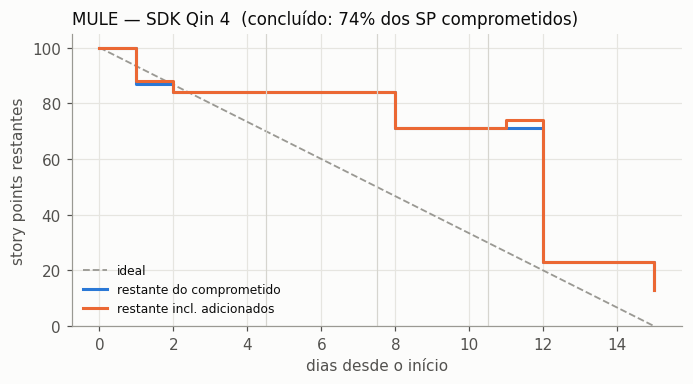
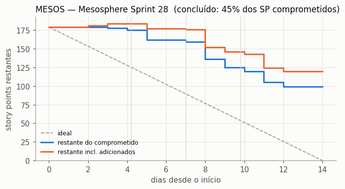
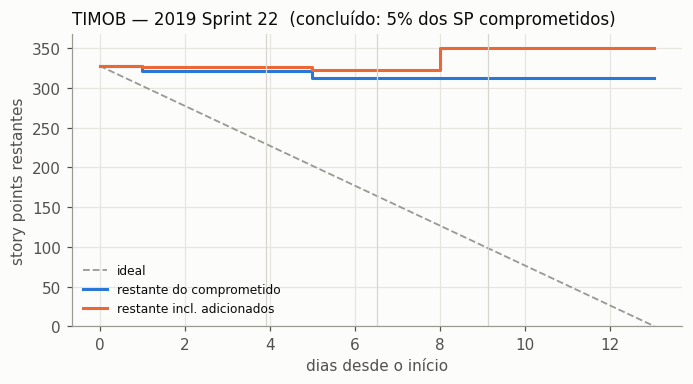
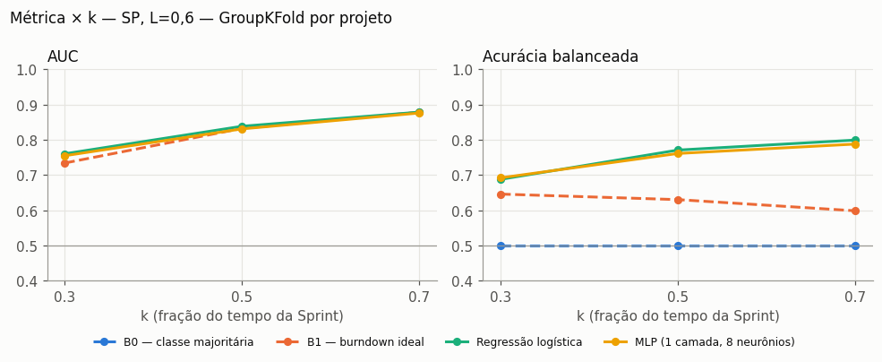
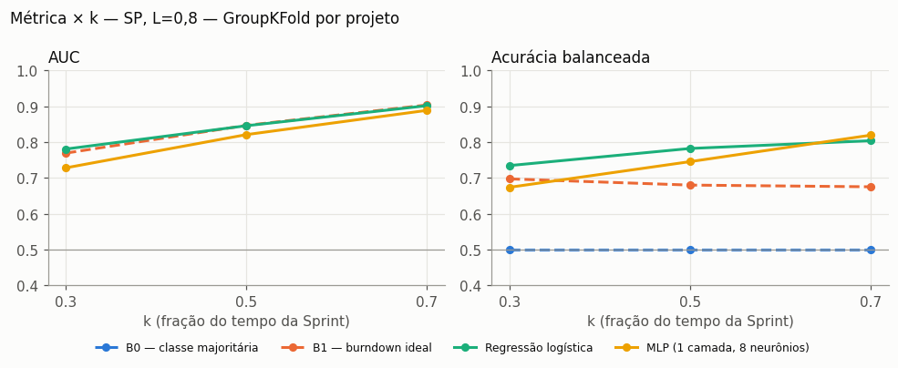

# Viabilidade: alerta antecipado de Sprint com dados reais do TAWOS

> Disciplina de Inteligência Artificial: Redes Neurais (Perceptron, Adaline, PMC). Referência: Silva, Spatti & Flauzino, *Redes Neurais Artificiais para Engenharia e Ciências Aplicadas*.
> Dados: TAWOS v1.1 (Tawosi et al., MSR 2022, DOI 10.5522/04/21308124), licença Apache 2.0, uso em pesquisa.
> Reprodução: ver `README.md`. Os números deste relatório saem de `scripts/rodar_tudo.sh`.

## 1. Resumo executivo

**Veredito: SIGA COM AJUSTES.** O histórico do campo `Sprint` no `Change_Log` permite reconstruir o escopo comprometido, as entradas e saídas de itens e o *burndown* diário. A base resultante tem **1.166 Sprints com story points** de 33 projetos (2.027 Sprints de 35 projetos contando itens), acima do mínimo de 300.
A curva central do trabalho aparece: a AUC sobe com *k* (≈ 0,77 → 0,85 → 0,90).
Há dois ajustes necessários. (1) Os projetos *open source* raramente cumprem ≥ 80% do que comprometem (10,9% das Sprints), então nenhum L do roteiro chega aos 20% de classe minoritária (L = 0,6 chegaria a 25%). **Decisão do usuário (28/10/2026): manter L = 0,8**, com ponderação de classes e métricas balanceadas; ver `reports/decisoes.md`. (2) Em *k* = 0,5 os modelos superam B1 em acurácia balanceada (0,78 contra 0,68), mas **empatam em AUC** (0,85): quase todo o sinal está na própria folga do *burndown*. É preciso acrescentar variáveis.

## 2. Ambiente, download e importação

| Item | Valor |
|---|---|
| Dump | `TAWOS.sql.zip` (Figshare, arquivo 37806375): **637.550.449 bytes (608 MiB)**, MD5 `e9c5ecc7649d55f0cf2fb4efb5664494` (confere com o Figshare) |
| Tempo de download | 41 s |
| Descompactado | `TAWOS.sql`, 4.313.856.480 bytes (4,0 GiB), em 18 s |
| SGBD | MySQL Community **8.0.22**, a mesma versão do dump (o cabeçalho indica servidor de origem 8.0.21, mysqldump 8.0.30) |
| Tempo de importação | **340 s** (`innodb_buffer_pool_size=1G`, `innodb_flush_log_at_trx_commit=2`, sem binlog) |
| Contagens após a importação | 458.232 issues, 39 projetos, 12 repositórios, 4.594 Sprints, 9.253.419 mudanças: batem com o README |
| Consultas de extração (`sql/01–11`) | ~6 min; pipeline Python (reconstrução, base e modelos) ~3,5 min |
| Python | 3.10, pandas 2.3.3, scikit-learn 1.7.2 |

**Problemas encontrados e como foram contornados:**

- **Docker indisponível.** `docker compose up` falhou com `permission denied while trying to connect to the docker API at unix:///var/run/docker.sock`: o daemon estava inativo e o usuário não pertence ao grupo `docker`, o que exigiria `sudo`. O `docker-compose.yml` continua no projeto como caminho recomendado. Para não depender de root, usei o tarball oficial do MySQL 8.0.22 em espaço de usuário (`scripts/mysql_local.sh`). Ele precisa de `libaio`, extraída do pacote do Arch, e de *shims* `ncurses5`, ambos num diretório local, sem tocar no sistema.
- O dump não tem `CREATE DATABASE`/`USE` (o banco de origem se chamava `tawos_cleaned`), por isso foi importado no banco `TAWOS`.
- Nomes reais diferentes do roteiro, conferidos no script do esquema antes de escrever as consultas (detalhes em `reports/esquema_tawos.md`): `Sprint.Complete_Date` (não `Completion_Date`); `Change_Log.Change_Type` (não `ChangeType`); **não existe tabela de ligação Issue–Sprint**, só `Issue.Sprint_ID` (N:1); `Project.SP_Field_ID` existe no dump, mas não no script do GitHub.
- Uma Sprint tem datas no ano **0015** (erro de preenchimento) e foi descartada como data inválida. Há *story points* absurdos (−1, 1.000, 26.710.114); valores fora de [0, 100] são tratados como ausentes.

## 3. As três perguntas decisivas

### P1 — Há Sprints suficientes com datas?

**Sim.** Das 4.594 Sprints, 4.542 têm `Start_Date` e `End_Date` válidos. Por estado: CLOSED 4.507, FUTURE 51 (sem datas) e ACTIVE 36. Três projetos (SERVER, DNN e EVG) não têm nenhuma Sprint. `Activated_Date` só está preenchido em 342 Sprints e coincide com `Start_Date` (mediana da diferença: 0 h), por isso o início considerado é o `Start_Date`. `Complete_Date` costuma vir depois do `End_Date` (mediana +0,3 dia).

"Aderente" = ao menos 70% das Sprints com duração arredondada entre 7 e 28 dias. "Itens" = issues ligadas por `Issue.Sprint_ID`, que subestima o escopo real (ver P2.3).

| Projeto | Sprints | c/ Start e End | Dur. Q1 | Dur. mediana | Dur. Q3 | % 7–28 d | Itens Q1 | Itens mediana | Itens Q3 | Aderente |
|---|---:|---:|---:|---:|---:|---:|---:|---:|---:|---|
| CONFSERVER | 565 | 560 | 7,0 | 13,0 | 14,0 | 92% | 0 | 1 | 2 | sim |
| CONFCLOUD | 477 | 470 | 7,0 | 11,0 | 14,0 | 89% | 0 | 0 | 2 | sim |
| DM | 396 | 393 | 13,0 | 26,1 | 29,6 | 64% | 9 | 20 | 31 | **não** |
| MULE | 311 | 298 | 14,0 | 14,0 | 14,0 | 99% | 2 | 7 | 17 | sim |
| TIMOB | 301 | 301 | 11,6 | 14,0 | 14,0 | 99% | 4 | 11 | 20 | sim |
| MESOS | 227 | 227 | 14,0 | 14,0 | 14,0 | 99% | 3 | 9 | 17 | sim |
| TIDOC | 217 | 215 | 7,0 | 7,0 | 14,0 | 81% | 1 | 3 | 7 | sim |
| TISTUD | 163 | 163 | 11,4 | 14,0 | 14,0 | 100% | 2 | 5 | 12 | sim |
| MDL | 151 | 150 | 14,0 | 17,3 | 18,3 | 97% | 2 | 6 | 20 | sim |
| NEXUS | 143 | 143 | 14,0 | 14,0 | 14,0 | 100% | 1 | 5 | 10 | sim |
| FAB | 142 | 135 | 11,7 | 14,0 | 14,0 | 96% | 2 | 8 | 20 | sim |
| APIKIT | 124 | 122 | 13,6 | 14,0 | 14,0 | 98% | 1 | 3 | 6 | sim |
| ALOY | 118 | 118 | 11,5 | 14,0 | 14,0 | 100% | 0 | 1 | 3 | sim |
| FE | 109 | 109 | 13,0 | 14,2 | 18,3 | 89% | 0 | 1 | 2 | sim |
| CLI | 98 | 98 | 11,6 | 14,0 | 14,0 | 100% | 0 | 2 | 4 | sim |
| COMPASS | 91 | 90 | 7,0 | 13,8 | 13,8 | 97% | 4 | 8 | 13 | sim |
| INDY | 76 | 75 | 13,0 | 14,0 | 14,0 | 97% | 8 | 12 | 22 | sim |
| IS | 75 | 74 | 13,0 | 14,0 | 14,0 | 100% | 6 | 10 | 17 | sim |
| JSWCLOUD | 74 | 74 | 13,0 | 14,0 | 14,0 | 96% | 1 | 2 | 20 | sim |
| JSWSERVER | 70 | 70 | 14,0 | 14,0 | 14,0 | 96% | 1 | 5 | 28 | sim |
| XD | 66 | 66 | 8,5 | 11,3 | 14,5 | 86% | 18 | 28 | 42 | sim |
| DAEMON | 62 | 62 | 13,0 | 14,0 | 14,0 | 100% | 0 | 1 | 3 | sim |
| JRACLOUD | 59 | 59 | 13,0 | 14,0 | 14,0 | 100% | 0 | 3 | 6 | sim |
| CXX | 56 | 56 | 18,0 | 18,0 | 20,9 | 100% | 2 | 6 | 13 | sim |
| DATACASS | 54 | 54 | 11,0 | 14,9 | 25,5 | 81% | 1 | 3 | 9 | sim |
| JRASERVER | 50 | 50 | 14,0 | 14,0 | 14,0 | 100% | 2 | 4 | 8 | sim |
| CLOV | 48 | 47 | 11,1 | 14,0 | 14,5 | 96% | 1 | 2 | 4 | sim |
| BE | 47 | 46 | 11,0 | 11,4 | 11,5 | 96% | 4 | 10 | 14 | sim |
| JAVA | 46 | 46 | 18,0 | 18,0 | 18,0 | 87% | 9 | 18 | 24 | sim |
| CWD | 44 | 44 | 7,0 | 7,0 | 7,0 | 80% | 1 | 4 | 5 | sim |
| MXNET | 41 | 40 | 13,8 | 14,0 | 14,0 | 100% | 1 | 4 | 10 | sim |
| USERGRID | 38 | 36 | 7,0 | 14,0 | 14,0 | 94% | 8 | 12 | 16 | sim |
| STL | 22 | 22 | 14,0 | 21,5 | 26,5 | 86% | 30 | 44 | 51 | sim |
| BAM | 14 | 12 | 14,0 | 14,0 | 14,0 | 92% | 1 | 2 | 3 | sim |
| APSTUD | 12 | 12 | 11,1 | 11,5 | 13,2 | 100% | 0 | 0 | 1 | sim |
| DURACLOUD | 7 | 5 | 21,0 | 27,0 | 28,0 | 80% | 6 | 8 | 19 | sim |

Só o **DM** fica fora pelo critério 7–28, porque trabalha em ciclos mensais (Q3 = 29,6 dias). Com o limite de 31 dias, 93% das suas Sprints passam, e é exatamente esse o filtro de duração da Etapa 3. Como o DM é o projeto com maior cobertura de SP (90%), ele **foi mantido**. CONFSERVER e CONFCLOUD têm muitas Sprints, mas quase sem itens públicos ligados (mediana de 0–1), e acabam caindo pelo filtro de ≥ 5 itens comprometidos.

### P2 — O histórico de mudanças permite reconstruir escopo e conclusão?

**Sim, e essa é a descoberta que viabiliza o estudo.**

**2.1 Campos por `Change_Type`** (`data/raw/csv/03_changelog_campos.csv`, 435 combinações):

| Change_Type | Mudanças | Campos relevantes |
|---|---:|---|
| STATUS | 1.779.677 | `status` (1.363.475), `resolution` (416.202) |
| STORY_POINT | 49.195 | `Story Points` (48.225), `Actual Story Points` (541), `QA Story Points` (283), `Story Points (Obsolete)` (146) |
| OTHER | 6.726.893 | **`Sprint` (174.915 mudanças em 71.376 issues)**, `Rank` (455.498), `Flagged` (455), `Sprint candidate` (5.968)… |
| PEOPLE | 349.551 | responsável e relator |
| DESCRIPTION | 348.103 | título e descrição |

**Existem mudanças no campo "Sprint".** `From_Value`/`To_Value` guardam a **lista completa** de Sprints (IDs Jira) antes e depois de cada mudança. Exemplos: `'2278'` → `'2278, 2296'` (*carry-over* ao fechar a Sprint 2278) e `NULL` → `'351'` (entrada na Sprint). Com isso dá para saber, em qualquer instante, a quais Sprints cada issue pertencia. Detalhes: `JiraID` é único por projeto, e não por repositório (uma Sprint compartilhada aparece uma vez por projeto). 92,7% das referências dos projetos com Sprints são mapeadas; as demais apontam para Sprints de outros projetos ou ausentes do dump. Em 0,9% das mudanças (1.518), o `From_Value` não bate com o `To_Value` anterior, e prevalece o valor mais recente.

**2.2 Status que contam como "concluído".** Uso a primeira entrada em `{Closed, Resolved, Done, Complete, Completed}`, depois de normalizar caixa e espaços (há 2.840 transições para `RESOLVED` em maiúsculas). Conjunto de cada projeto, com o número de transições para issues em Sprints:

| Projetos | Status de conclusão usados |
|---|---|
| ALOY, BAM, CLI, CLOV, CONFCLOUD, CWD, CXX, DAEMON, FE, JAVA, JRACLOUD, JRASERVER, JSWSERVER, TIDOC, TIMOB, TISTUD, USERGRID | Resolved e/ou Closed (Resolved → Closed: a 1ª entrada, Resolved, é a que vale) |
| MESOS | Resolved (3.597), Closed (58) |
| MDL, COMPASS, DURACLOUD | Closed |
| DM, XD, MXNET | Done (DM: `Won't Fix` e `Invalid` são estados terminais **sem entrega** e não contam) |
| BE, INDY, IS, STL | Done e Complete |
| MULE, APIKIT, DATACASS, CONFSERVER, JSWCLOUD, NEXUS, FAB | Closed, Done e/ou Resolved |

Transições mais comuns, por exemplo: MESOS `Accepted→In Progress` (3.048), `In Progress→Reviewable` (2.497); TIMOB `Resolved→Closed` (4.347), `Open→In Progress` (3.426); DM `To Do→In Progress` (6.806), `Reviewed→Done` (5.286). A lista completa está em `data/raw/csv/04_transicoes_status.csv`. Itens reabertos contam pela 1ª conclusão **após** o início da Sprint. Para a variável `itens_em_andamento_rel`, todo status que não seja de conclusão nem de "a fazer/aguardando" (lista em `src/data/reconstrucao.py`) conta como "em andamento".

**2.3 *Carry-over*.** Não há tabela de ligação. `Issue.Sprint_ID` guarda **uma** Sprint, de forma inconsistente: entre as 18.864 issues que passaram por mais de uma Sprint, ele aponta para a primeira em 61%, para a última em 25%, e é nulo em 17%. **A ligação estática não serve para reconstruir escopo; a fonte confiável é o histórico do campo Sprint.** As 9.645 issues com `Sprint_ID` mas sem histórico (criadas direto na Sprint e nunca movidas) foram consideradas membros dessa Sprint desde a criação.

### P3 — Há story points suficientes?

**Em parte.** Medi a cobertura no escopo comprometido, com o SP **vigente no início da Sprint** (reconstruído pelo histórico de `Story Points`, sem vazamento). Ela é bem menor do que a do valor final, porque muitas estimativas entram depois do início.

| Projeto | Itens comprometidos (todas as Sprints) | % com SP no início | % com SP (valor final) | Sprints c/ ≥1 comprometido |
|---|---:|---:|---:|---:|
| DM | 10587 | 90% | 93% | 332 |
| TIMOB | 4525 | 76% | 86% | 257 |
| MULE | 2613 | 85% | 97% | 261 |
| MESOS | 2585 | 71% | 84% | 199 |
| CONFSERVER | 1762 | 36% | 50% | 450 |
| TISTUD | 1630 | 84% | 95% | 136 |
| XD | 1492 | 100% | 100% | 66 |
| TIDOC | 1414 | 65% | 92% | 176 |
| INDY | 1336 | 42% | 48% | 75 |
| COMPASS | 1228 | 38% | 44% | 87 |
| IS | 1099 | 61% | 65% | 69 |
| STL | 1063 | 90% | 93% | 22 |
| MDL | 1042 | 69% | 81% | 85 |
| CONFCLOUD | 772 | 18% | 24% | 190 |
| NEXUS | 762 | 71% | 81% | 132 |
| FAB | 717 | 17% | 21% | 75 |
| JSWSERVER | 590 | 39% | 44% | 55 |
| JSWCLOUD | 543 | 44% | 50% | 62 |
| APIKIT | 507 | 71% | 79% | 103 |
| CXX | 488 | 29% | 31% | 48 |
| USERGRID | 456 | 57% | 80% | 35 |
| JRASERVER | 395 | 92% | 100% | 45 |
| BE | 386 | 48% | 73% | 44 |
| MXNET | 321 | 16% | 32% | 37 |
| CLI | 270 | 70% | 90% | 55 |
| JAVA | 247 | 17% | 26% | 30 |
| ALOY | 222 | 47% | 59% | 51 |
| DATACASS | 219 | 28% | 28% | 31 |
| CWD | 186 | 65% | 88% | 42 |
| FE | 182 | 73% | 91% | 74 |
| CLOV | 121 | 90% | 98% | 41 |
| JRACLOUD | 85 | 81% | 98% | 36 |
| BAM | 66 | 2% | 2% | 12 |
| DAEMON | 47 | 23% | 89% | 18 |
| DURACLOUD | 18 | 0% | 72% | 3 |
| APSTUD | 11 | 64% | 64% | 7 |

Decisão: **duas unidades em paralelo.** Story points nas Sprints com ≥ 70% dos itens comprometidos estimados no início (1.166 Sprints) e contagem de itens em todas as Sprints filtradas (2.027). Itens sem SP entram com 0 nas somas de pontos.

## 4. Método de reconstrução

Implementado em `src/data/reconstrucao.py` e `src/data/sprints_reconstruidas.py`.

1. **Pertinência issue↔Sprint ao longo do tempo** (`data/interim/pertinencia_issue_sprint.csv`): cada mudança do campo Sprint fecha os intervalos das Sprints que saíram da lista e abre os das que entraram. Antes da 1ª mudança, a issue pertence às Sprints de `From_Value` desde a sua criação.
2. **Escopo comprometido:** itens na Sprint em `Start_Date` + **1 h de tolerância**. Justificativa: há um pico de entradas entre 15 min e 1 h após o `Start_Date` (9.343 entradas contra 1.065 nos primeiros 15 min), efeito do próprio ato de iniciar a Sprint e mover o restante da anterior. Itens **já concluídos** nesse momento ficam fora do compromisso: 2.310 itens, a maioria resíduo de Sprints anteriores. Os reabertos (cerca de 1/3 dos casos inicialmente suspeitos) contam normalmente. **Nenhum substituto foi necessário**: o histórico do campo Sprint existe.
3. **Escopo adicionado e removido:** entradas em (início + 1 h, `End_Date`] e saídas de itens comprometidos até `End_Date`, com datas. No total: 42.691 vínculos comprometidos, 36.034 adicionados e 4.560 remoções.
4. **Conclusão:** primeira entrada num status de conclusão após o início. Para issues sem histórico de status, usa-se `Resolution_Date`.
5. **Story points:** valor vigente no início (comprometidos) ou na entrada (adicionados), congelado.
6. **Burndown diário** (`src/data/amostra.py`): pontos restantes do comprometido e pontos restantes incluindo os adicionados.

**Validação na amostra.** Foram 20 Sprints CLOSED com ≥ 5 itens e cobertura ≥ 70%, sorteadas com semente 42: 7 do MESOS, 7 do MULE e 6 do TIMOB (`data/interim/amostra_poc.csv`; gráficos em `figures/burndown_amostra/`). Nas 20, o *burndown* do comprometido é monotonicamente não crescente, e restante final + concluído + removido-não-concluído = comprometido. Na inspeção visual, os degraus coincidem com fechamentos de itens e as entradas aparecem como subidas da curva laranja. A incoerência investigada foi a do TIMOB "2019 Sprint 22": 5% concluído e 13 itens já fechados no início. Não é erro de reconstrução: a maioria dos itens comprometidos foi fechada de 1 a 9 meses depois (mediana de 176 dias após o fim), já em 2019, quando o projeto estava em declínio. No conjunto todo, 1.101 Sprints não têm nenhum item comprometido, quase todas do CONFSERVER e CONFCLOUD, cujas issues públicas raramente estão em Sprints. Elas caem no filtro de ≥ 5 itens.

## 5. Rótulo e sensibilidade a L

`cumpriu = (SP comprometidos concluídos até End_Date) / (SP comprometidos) ≥ L`. A versão por itens troca SP por contagem. Itens removidos durante a Sprint contam como **não** cumpridos, porque o compromisso original não foi entregue. O rótulo usa `End_Date`, como pede o roteiro; só 2,5% dos itens comprometidos fecham no dia seguinte ao fim, então usar `Complete_Date` mudaria pouco.

| L | % "cumpriu" (SP, n = 1.166) | % "cumpriu" (itens, n = 2.027) |
|---:|---:|---:|
| 0,5 | 36,4% | 41,7% |
| **0,6** | **25,2%** | **30,0%** |
| 0,7 | 16,0% | 19,2% |
| 0,8 | 10,9% | 13,0% |
| 0,9 | 5,9% | 5,1% |
| 1,0 | 3,3% | 2,9% |

A fração mediana concluída é de **38%** dos SP comprometidos. Na mediana, as equipes comprometem **2,3×** a média entregue nas 3 Sprints anteriores. Nos projetos *open source*, a Sprint funciona mais como "lista de candidatos" do que como compromisso firme. **Nenhum L do roteiro (0,8 / 0,9 / 1,0) atinge os 20% de classe minoritária.** Este estudo chegou a recomendar L = 0,6 (25% de positivos em SP). **Decisão do usuário (D1, 28/10/2026): L = 0,8** (10,9% de positivos em SP). Consequência: o critério de 20% de classe minoritária não é atendido, então a modelagem precisa de `class_weight="balanced"` (ou sobreamostragem só no treino) e deve ser julgada por acurácia balanceada, F1 e AUC, nunca por acurácia simples. L = 0,6 fica só como análise de sensibilidade.

## 6. Base final: tamanho e balanceamento

Arquivo `data/processed/base_modelagem.csv`: uma linha por Sprint × *k* (6.081 linhas = 2.027 × 3), com as colunas `projeto`, `usa_sp` e os rótulos `cumpriu_{sp,itens}_L{80,90,100}`. O rótulo L = 0,6 é derivado de `frac_*_final`. Funil de filtros (`data/processed/base_filtros.csv`):

| Etapa | Sprints |
|---|---:|
| Sprints na tabela `Sprint` | 4.594 |
| com `Start_Date` e `End_Date` válidos | 4.542 |
| `State` = CLOSED (ACTIVE ainda não terminaram) | 4.506 |
| duração de 5 a 31 dias | 4.323 |
| ≥ 5 itens comprometidos | **2.027** (unidade: itens) |
| cobertura de SP no início ≥ 70% e SP > 0 | **1.166** (unidade: SP) |

| Projeto | Sprints (itens) | cumpriu L=0,6 (itens) | cumpriu L=0,8 (itens) | Sprints (SP) | L=0,6 (SP) | L=0,8 (SP) | L=0,9 (SP) | L=1,0 (SP) |
|---|---:|---:|---:|---:|---:|---:|---:|---:|
| DM | 277 | 5% | 1% | 237 | 5% | 1% | 1% | 0% |
| TIMOB | 191 | 18% | 6% | 130 | 17% | 6% | 4% | 2% |
| MULE | 159 | 69% | 30% | 124 | 57% | 27% | 15% | 7% |
| MESOS | 135 | 12% | 4% | 94 | 14% | 5% | 1% | 1% |
| CONFSERVER | 135 | 15% | 2% | 42 | 7% | 0% | 0% | 0% |
| TISTUD | 119 | 29% | 11% | 99 | 27% | 13% | 4% | 0% |
| TIDOC | 89 | 36% | 16% | 54 | 37% | 22% | 13% | 7% |
| COMPASS | 77 | 17% | 1% | 6 | 0% | 0% | 0% | 0% |
| INDY | 71 | 39% | 13% | 31 | 42% | 10% | 3% | 3% |
| MDL | 67 | 16% | 9% | 40 | 15% | 5% | 2% | 2% |
| CONFCLOUD | 60 | 15% | 5% | 8 | 0% | 0% | 0% | 0% |
| NEXUS | 60 | 82% | 65% | 37 | 68% | 54% | 46% | 35% |
| IS | 57 | 30% | 11% | 26 | 15% | 4% | 4% | 4% |
| XD | 55 | 69% | 33% | 55 | 58% | 25% | 7% | 4% |
| APIKIT | 49 | 35% | 12% | 33 | 27% | 6% | 3% | 0% |
| FAB | 44 | 14% | 9% | 5 | 0% | 0% | 0% | 0% |
| JRASERVER | 39 | 15% | 3% | 38 | 16% | 3% | 0% | 0% |
| USERGRID | 35 | 23% | 6% | 12 | 25% | 8% | 0% | 0% |
| JSWSERVER | 34 | 91% | 56% | 2 | 50% | 0% | 0% | 0% |
| JSWCLOUD | 33 | 91% | 52% | 5 | 60% | 0% | 0% | 0% |
| CXX | 30 | 37% | 17% | 8 | 25% | 25% | 12% | 0% |
| BE | 29 | 38% | 7% | 10 | 10% | 10% | 0% | 0% |
| MXNET | 28 | 21% | 7% | 3 | 33% | 0% | 0% | 0% |
| CLI | 25 | 12% | 0% | 17 | 0% | 0% | 0% | 0% |
| JAVA | 22 | 41% | 23% | 1 | 100% | 100% | 100% | 0% |
| STL | 22 | 41% | 0% | 19 | 26% | 5% | 0% | 0% |
| CWD | 20 | 55% | 30% | 7 | 57% | 0% | 0% | 0% |
| DATACASS | 18 | 11% | 6% | 3 | 33% | 0% | 0% | 0% |
| ALOY | 16 | 81% | 38% | 7 | 57% | 14% | 14% | 0% |
| BAM | 7 | 0% | 0% | 0 | – | – | – | – |
| FE | 7 | 57% | 43% | 3 | 67% | 67% | 67% | 67% |
| JRACLOUD | 6 | 17% | 0% | 5 | 0% | 0% | 0% | 0% |
| CLOV | 5 | 40% | 20% | 4 | 50% | 50% | 25% | 25% |
| DAEMON | 3 | 0% | 0% | 1 | 0% | 0% | 0% | 0% |
| DURACLOUD | 3 | 67% | 33% | 0 | – | – | – | – |
| **Total** | 2027 | 30% | 13% | 1166 | 25% | 11% | 6% | 3% |

O balanceamento varia muito entre projetos: DM, com 237 Sprints em SP, tem só 5% de positivos em L = 0,6, enquanto NEXUS e MULE passam de 55%. É mais um motivo para avaliar com divisão por projeto.

## 7. Resultados: baselines × modelos, por *k*

Variáveis (unidade SP): `pct_tempo`, `pct_pontos_concluidos`, `pontos_adicionados_rel`, `itens_em_andamento_rel`, `compromisso_vs_velocidade` (ausente em 4% das Sprints da base SP, imputado pela mediana do treino com indicador de ausência) e `duracao_dias`. Na unidade itens, as equivalentes por contagem. Todas são calculadas só com eventos de data ≤ *tk*; a velocidade usa só Sprints do mesmo projeto com `End_Date` ≤ início da Sprint atual. Pré-processamento: imputação, `log1p` (as razões têm cauda longa) e padronização, ajustados só no treino. Um modelo é treinado com todos os *k* juntos e avaliado separadamente em cada *k*. Regressão logística com `class_weight="balanced"`; `MLPClassifier(8)` com sobreamostragem dos positivos no treino.

**Avaliação principal:** `GroupKFold` por projeto (5 dobras), com métricas sobre as predições fora da dobra. **Secundária:** divisão temporal dentro de cada projeto (as 70% Sprints mais antigas treinam, as 30% mais recentes testam). Células: **acurácia / acurácia balanceada / F1 / AUC**. B1 = "cumpre se `pct_concluido ≥ pct_tempo`"; a AUC de B1 usa a folga `pct_concluido − pct_tempo` como escore.

#### SP, L=0,8 — GroupKFold por projeto

| Modelo | k=0,3 | k=0,5 | k=0,7 |
|---|---|---|---|
| B0 — classe majoritária | 0,89 / 0,50 / 0,00 / – | 0,89 / 0,50 / 0,00 / – | 0,89 / 0,50 / 0,00 / – |
| B1 — burndown ideal | 0,87 / 0,70 / 0,44 / 0,77 | 0,90 / 0,68 / 0,46 / 0,85 | 0,92 / 0,68 / 0,50 / 0,90 |
| Regressão logística | 0,75 / 0,73 / 0,38 / 0,78 | 0,80 / 0,78 / 0,45 / 0,85 | 0,80 / 0,80 / 0,47 / 0,90 |
| MLP (1 camada, 8 neurônios) | 0,74 / 0,67 / 0,33 / 0,73 | 0,81 / 0,75 / 0,43 / 0,82 | 0,83 / 0,82 / 0,51 / 0,89 |

#### SP, L=0,8 — temporal por projeto

| Modelo | k=0,3 | k=0,5 | k=0,7 |
|---|---|---|---|
| B0 — classe majoritária | 0,89 / 0,50 / 0,00 / – | 0,89 / 0,50 / 0,00 / – | 0,89 / 0,50 / 0,00 / – |
| B1 — burndown ideal | 0,87 / 0,71 / 0,46 / 0,76 | 0,90 / 0,68 / 0,47 / 0,86 | 0,92 / 0,65 / 0,45 / 0,92 |
| Regressão logística | 0,77 / 0,70 / 0,37 / 0,80 | 0,83 / 0,80 / 0,50 / 0,88 | 0,82 / 0,82 / 0,50 / 0,92 |
| MLP (1 camada, 8 neurônios) | 0,77 / 0,74 / 0,41 / 0,81 | 0,84 / 0,80 / 0,51 / 0,88 | 0,84 / 0,80 / 0,51 / 0,92 |

#### SP, L=0,6 — GroupKFold por projeto

| Modelo | k=0,3 | k=0,5 | k=0,7 |
|---|---|---|---|
| B0 — classe majoritária | 0,75 / 0,50 / 0,00 / – | 0,75 / 0,50 / 0,00 / – | 0,75 / 0,50 / 0,00 / – |
| B1 — burndown ideal | 0,79 / 0,65 / 0,46 / 0,73 | 0,81 / 0,63 / 0,42 / 0,83 | 0,80 / 0,60 / 0,33 / 0,88 |
| Regressão logística | 0,71 / 0,69 / 0,53 / 0,76 | 0,77 / 0,77 / 0,63 / 0,84 | 0,79 / 0,80 / 0,66 / 0,88 |
| MLP (1 camada, 8 neurônios) | 0,68 / 0,69 / 0,53 / 0,75 | 0,77 / 0,76 / 0,62 / 0,83 | 0,78 / 0,79 / 0,65 / 0,88 |

#### SP, L=0,6 — temporal por projeto

| Modelo | k=0,3 | k=0,5 | k=0,7 |
|---|---|---|---|
| B0 — classe majoritária | 0,79 / 0,50 / 0,00 / – | 0,79 / 0,50 / 0,00 / – | 0,79 / 0,50 / 0,00 / – |
| B1 — burndown ideal | 0,82 / 0,67 / 0,48 / 0,74 | 0,84 / 0,65 / 0,45 / 0,84 | 0,82 / 0,58 / 0,29 / 0,91 |
| Regressão logística | 0,74 / 0,71 / 0,52 / 0,79 | 0,79 / 0,77 / 0,60 / 0,86 | 0,84 / 0,85 / 0,69 / 0,91 |
| MLP (1 camada, 8 neurônios) | 0,75 / 0,74 / 0,55 / 0,80 | 0,79 / 0,80 / 0,62 / 0,86 | 0,83 / 0,84 / 0,68 / 0,92 |

Unidade itens (2.027 Sprints)

#### itens, L=0,8 — GroupKFold por projeto

| Modelo | k=0,3 | k=0,5 | k=0,7 |
|---|---|---|---|
| B0 — classe majoritária | 0,87 / 0,50 / 0,00 / – | 0,87 / 0,50 / 0,00 / – | 0,87 / 0,50 / 0,00 / – |
| B1 — burndown ideal | 0,84 / 0,74 / 0,50 / 0,81 | 0,89 / 0,75 / 0,57 / 0,87 | 0,93 / 0,76 / 0,65 / 0,91 |
| Regressão logística | 0,77 / 0,76 / 0,45 / 0,83 | 0,80 / 0,80 / 0,51 / 0,88 | 0,83 / 0,84 / 0,57 / 0,91 |
| MLP (1 camada, 8 neurônios) | 0,76 / 0,74 / 0,43 / 0,82 | 0,81 / 0,78 / 0,50 / 0,87 | 0,84 / 0,84 / 0,58 / 0,91 |

#### itens, L=0,8 — temporal por projeto

| Modelo | k=0,3 | k=0,5 | k=0,7 |
|---|---|---|---|
| B0 — classe majoritária | 0,89 / 0,50 / 0,00 / – | 0,89 / 0,50 / 0,00 / – | 0,89 / 0,50 / 0,00 / – |
| B1 — burndown ideal | 0,86 / 0,74 / 0,49 / 0,80 | 0,89 / 0,73 / 0,53 / 0,88 | 0,93 / 0,74 / 0,63 / 0,92 |
| Regressão logística | 0,82 / 0,76 / 0,47 / 0,84 | 0,84 / 0,79 / 0,51 / 0,89 | 0,85 / 0,85 / 0,57 / 0,92 |
| MLP (1 camada, 8 neurônios) | 0,82 / 0,73 / 0,44 / 0,83 | 0,83 / 0,78 / 0,49 / 0,88 | 0,86 / 0,86 / 0,59 / 0,93 |

#### itens, L=0,6 — GroupKFold por projeto

| Modelo | k=0,3 | k=0,5 | k=0,7 |
|---|---|---|---|
| B0 — classe majoritária | 0,70 / 0,50 / 0,00 / – | 0,70 / 0,50 / 0,00 / – | 0,70 / 0,50 / 0,00 / – |
| B1 — burndown ideal | 0,79 / 0,69 / 0,56 / 0,78 | 0,80 / 0,69 / 0,55 / 0,85 | 0,78 / 0,63 / 0,42 / 0,90 |
| Regressão logística | 0,74 / 0,73 / 0,62 / 0,79 | 0,79 / 0,78 / 0,69 / 0,86 | 0,81 / 0,81 / 0,72 / 0,90 |
| MLP (1 camada, 8 neurônios) | 0,74 / 0,73 / 0,62 / 0,80 | 0,80 / 0,79 / 0,70 / 0,86 | 0,83 / 0,82 / 0,74 / 0,91 |

#### itens, L=0,6 — temporal por projeto

| Modelo | k=0,3 | k=0,5 | k=0,7 |
|---|---|---|---|
| B0 — classe majoritária | 0,72 / 0,50 / 0,00 / – | 0,72 / 0,50 / 0,00 / – | 0,72 / 0,50 / 0,00 / – |
| B1 — burndown ideal | 0,79 / 0,68 / 0,53 / 0,78 | 0,80 / 0,67 / 0,50 / 0,86 | 0,78 / 0,61 / 0,36 / 0,91 |
| Regressão logística | 0,79 / 0,75 / 0,64 / 0,81 | 0,81 / 0,78 / 0,69 / 0,88 | 0,85 / 0,84 / 0,75 / 0,92 |
| MLP (1 camada, 8 neurônios) | 0,79 / 0,74 / 0,63 / 0,82 | 0,82 / 0,78 / 0,68 / 0,87 | 0,86 / 0,84 / 0,77 / 0,91 |

Os demais cenários estão em `figures/metrica_vs_k_*.png`.

**Leitura dos resultados:**

- **A curva sobe com *k* em todos os cenários e nas duas divisões.** É o resultado central: AUC da regressão logística de 0,76 → 0,84 → 0,88 (SP, L = 0,6, por projeto) e de 0,78 → 0,85 → 0,90 (SP, L = 0,8).
- **Critério "modelo ≥ B1 em *k* = 0,5":** em acurácia balanceada e F1, os modelos superam B1 com folga (SP, L = 0,6: 0,77 contra 0,63 e 0,63 contra 0,42). Parte disso vem só de o limiar de B1 (folga ≥ 0) estar mal calibrado para a base desbalanceada. **Em AUC, que não depende de limiar, há empate** (0,84 contra 0,83; 0,85 contra 0,85).
- **Ablação** (`reports/ablacao_variaveis.csv`, regressão logística, por projeto):

  | Cenário | Variáveis | k=0,3 | k=0,5 | k=0,7 |
  |---|---|---:|---:|---:|
  | SP, L=0,8 | só burndown (pct_tempo + % concluído) | 0,77 | 0,85 | 0,90 |
  | SP, L=0,8 | todas | 0,78 | 0,85 | 0,90 |
  | SP, L=0,8 | todas − compromisso_vs_velocidade | 0,77 | 0,85 | 0,90 |
  | SP, L=0,8 | todas − itens_em_andamento_rel | 0,78 | 0,85 | 0,90 |
  | SP, L=0,8 | todas − adicionados_rel | 0,79 | 0,85 | 0,90 |
  | SP, L=0,6 | só burndown (pct_tempo + % concluído) | 0,73 | 0,83 | 0,88 |
  | SP, L=0,6 | todas | 0,76 | 0,84 | 0,88 |
  | SP, L=0,6 | todas − compromisso_vs_velocidade | 0,72 | 0,83 | 0,87 |
  | SP, L=0,6 | todas − itens_em_andamento_rel | 0,77 | 0,84 | 0,88 |
  | SP, L=0,6 | todas − adicionados_rel | 0,76 | 0,84 | 0,88 |

  `pct_tempo` + `% concluído` sozinhos já dão quase toda a AUC. `compromisso_vs_velocidade` é a única variável extra que agrega de forma consistente, sobretudo cedo (+0,01 a +0,04 de AUC em *k* = 0,3), justamente quando o alerta é mais útil. `itens_em_andamento_rel` e `adicionados_rel` não agregam nada mensurável.
- A MLP pequena não supera a regressão logística de forma consistente: o problema, com estas variáveis, é quase linearmente separável. Na divisão temporal os números são parecidos ou um pouco melhores, então não há sinal de vazamento por projeto.

## 8. Limitações

- **Substituto do Sprint Goal.** O TAWOS não tem o objetivo textual da Sprint. O rótulo mede o **compromisso quantitativo** (fração de SP ou itens comprometidos entregue). Uma equipe pode cumprir o Goal entregando 60% dos itens, ou falhar entregando 90%.
- **Projetos *open source* nem sempre seguem Scrum à risca.** Taxas de entrega muito baixas (mediana de 38%), compromissos de 2,3× a velocidade e projetos cujas issues públicas quase não entram em Sprints (CONFSERVER, CONFCLOUD) mostram que a Sprint às vezes é só um contêiner de planejamento. Daí a necessidade de baixar L para 0,6. Uma Sprint compartilhada por vários projetos é analisada por projeto, como no TAWOS; o que outras equipes fizeram fora do projeto não é observado.
- **Qualidade do preenchimento do Jira.** Há SP absurdos (tratados como ausentes), datas impossíveis (ano 0015), 0,9% de mudanças inconsistentes no campo Sprint, 7% de referências a Sprints ausentes do dump, `Issue.Sprint_ID` inconsistente e variações de nome de status (`RESOLVED`, `In  Review`). A lista "a fazer/em andamento" foi montada a partir dos status observados; um status não previsto conta como "em andamento".
- **Desbalanceamento entre projetos:** o DM (237 Sprints em SP) quase nunca cumpre; projetos pequenos têm poucas Sprints. As métricas agregadas misturam regimes muito diferentes.
- A tolerância de 1 h no início e o uso de `End_Date` são escolhas documentadas e alteram pouco os números; não fiz análise de sensibilidade completa delas.

## 9. Recomendação final

- **Projetos e filtros:** todos os 35 projetos com Sprints, usando os filtros da seção 6 (CLOSED, 5–31 dias, ≥ 5 comprometidos). **Unidade principal: story points** (cobertura ≥ 70% → **1.166 Sprints de 33 projetos**, 3.498 linhas Sprint × *k*). Base alternativa por itens: 2.027 Sprints, para conferir robustez. Recomendo reportar também os resultados sem o DM, porque ele é muito desbalanceado.
- **Rótulo (decisão do usuário, D1):** **L = 0,8** (10,9% de positivos em SP; exige ponderação de classes). L = 0,6 (25%) só como sensibilidade.
- **Unidade (decisão do usuário, D2):** **story points** como principal; contagem de itens só para verificar robustez.
- **Avaliação:** manter `GroupKFold` por projeto como protocolo principal e a divisão temporal como confirmação; comparar sempre com B1 por AUC e acurácia balanceada.
- **Variáveis finais (6 entradas + 1 indicador):** `pct_tempo`, `pct_pontos_concluidos`, `pontos_adicionados_rel`, `itens_em_andamento_rel`, `log1p(compromisso_vs_velocidade)`, `duracao_dias` e o indicador "velocidade ausente". Todas padronizadas (z-score) com estatísticas do treino. **Ajustes sugeridos para superar B1:**
  - comentários recentes: nº de comentários em (*tk* − 2 dias, *tk*] nos itens abertos;
  - mudanças de responsável (`Change_Type = PEOPLE`) desde o início;
  - itens marcados como `Flagged`. São só 463 mudanças, então essa variável deve ser fraca;
  - dependências via `Issue_Link` (`Depend`/`Blocks`) com itens abertos de fora da Sprint;
  - velocidade de *burndown* recente: pontos fechados nos últimos 20% do tempo decorrido;
  - histórico de cumprimento da equipe: fração das 3 Sprints anteriores com cumpriu = 1.
- **Topologia inicial sugerida:**
  - **Adaline:** 7 entradas + limiar (bias), 1 neurônio linear, rótulos bipolares {−1, +1}, regra delta (LMS) com taxa de aprendizado ~10⁻³–10⁻², parada por variação do EQM < 10⁻⁶ e função sinal na operação. Como um modelo linear já empata com B1, o Adaline deve ficar perto da regressão logística (AUC ≈ 0,84 em *k* = 0,5). Usar ponderação ou reamostragem das classes.
  - **PMC:** 7 entradas, **uma camada oculta com 4 a 15 neurônios** (faixa de busca; 2n + 1 = 15 pelo critério de Kolmogorov citado no livro), ativação logística ou tangente hiperbólica, 1 neurônio de saída logístico (probabilidade de cumprir) e limiar de decisão escolhido no treino para maximizar a acurácia balanceada. Treinar com *backpropagation* com *momentum* e validação cruzada por projeto para escolher o nº de neurônios. Com as variáveis atuais, a MLP de 8 neurônios não superou a logística; o PMC só deve se destacar depois que as variáveis extras acima forem incluídas.
  - **Perceptron simples:** útil só como referência didática; com classes que se sobrepõem, não converge.
